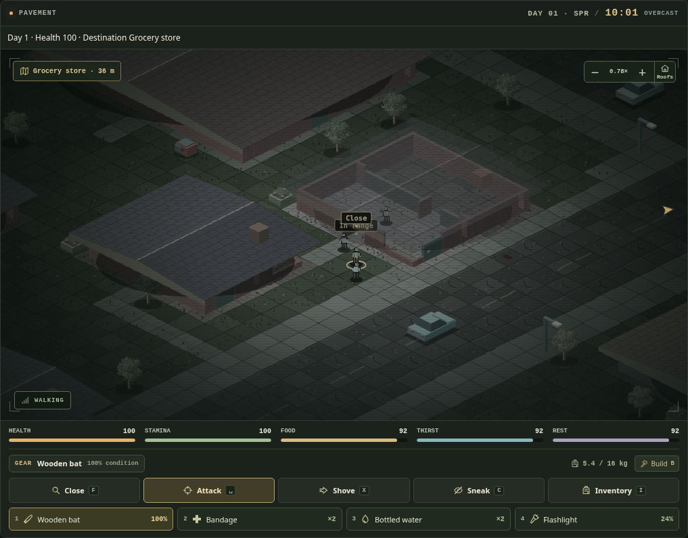
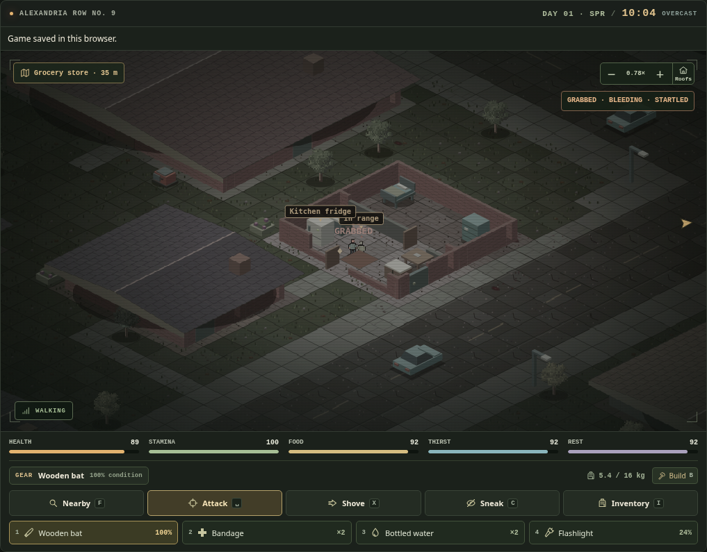

# Micro pixel art vertical slice

The playable slice uses Alexandria Row in the existing Cold Vale map. It has
a furnished cottage, neighbouring buildings, pavement, garden trees, a parked
car and infected. Select **Dark pixel** in the pause menu to see the new art.
The other graphics modes retain their existing art.

## Technical audit

| Existing system | What the slice uses |
| --- | --- |
| Canvas 2D and the isometric depth stack in `view.js` | Floors, props, actors and roofs keep the same draw order. Projection now uses a 64×32 diamond, with the same inverse for ground picking and rain placement. Keyboard and touch direction use the matching projection in `sim.js`. |
| Seeded maps and modular homes | Existing house footprints, doors, furniture, objects and region data supply the neighbourhood. The new art does not consume the seeded generator or change save schema. |
| Roof and wall cutaways | Entering a house removes its roof. Foreground walls keep their instant cutaway and their existing collision boundaries. |
| Terrain chunk cache and viewport culling | Pavement and floor details draw into cached chunks. Brick wall shapes, slate roofs and deciduous trees use cached canvases. Survivor and infected poses are packed into atlas pages and blitted per actor. |
| Audio, gameplay HUD, day/night and lighting | Existing interaction, survival, combat, flashlight, weather, and powered lights continue to run. The Dark Pixel colour grade is lighter in daylight to keep the small sprites legible. |

## Running and testing

The Cloudflare Worker Preview serves the game from `game/`. For local testing,
run `npx --yes wrangler@4.165.0 dev --local` at the repository root. The existing
`npm test` includes a ground-picking projection check and a sprite atlas check.
A Chromium smoke test used the regular game controls to cross the front door,
open nearby furniture actions and hit an infected.

These captures come from the running game with a repeatable test save. The
street image shows the approach to Alexandria Row. The second was taken after
walking into the furnished house with automatic roof visibility.

## Remaining work

Dedicated bathroom and shop interiors, more exterior and furniture variants,
a multi-frame death sequence, more detailed clothing and combat animations,
and a broader art pass across the other regions remain open. The current death
sprite shows the fallen pose. Real-device measurements are still needed before
assigning a desktop or Android FPS target to this build.
